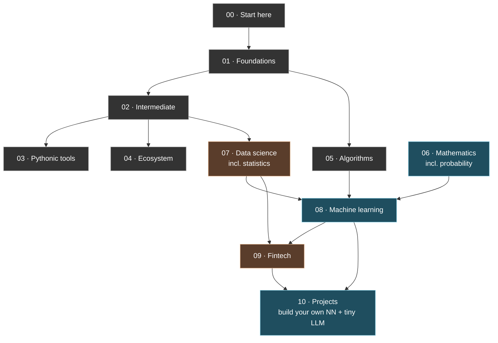

<div align="center">

# 🐍 Python Together

### A shared lab for **Python · Mathematics · Machine Learning · Fintech** — taught as runnable notebooks you can open in one click.

[](https://github.com/ANNYM25/python-together/actions/workflows/notebooks.yml)
[](https://github.com/ANNYM25/python-together/actions/workflows/gitleaks.yml)
[](https://www.python.org)
[](https://colab.research.google.com/github/ANNYM25/python-together)
[](LICENSE)


*From `print("hello")` all the way to building your own neural network and a tiny language model.*

</div>

---

> **Every lesson is a notebook.** Read the explanation, run the code cell under it,
> then do the `🏋️ Your turn`. Open any lesson in **Google Colab** (nothing to install)
> or run it locally in **Jupyter**. No prior experience needed to start.

Built by two people who both commit:

- **Lucifer** ([@R341CUL](https://github.com/R341CUL)) — computer science & machine learning
- **Anny** ([@ANNYM25](https://github.com/ANNYM25)) — sustainable finance & fintech

## Contents

- [Quick start](#-quick-start)
- [The learning path](#-the-learning-path)
- [Curriculum at a glance](#-curriculum-at-a-glance)
- [How a lesson is built](#-how-a-lesson-is-built)
- [Repository architecture](#-repository-architecture)
- [Working on this together](#-working-on-this-together)
- [Security](#-security)

## 🚀 Quick start

**Option A — Google Colab (zero install, best for beginners).**
Open any `.ipynb` on GitHub and click its **Open in Colab** badge. Full guide: [docs/setup-colab.md](docs/setup-colab.md).

**Option B — locally with Jupyter.**

```bash
git clone https://github.com/ANNYM25/python-together.git
cd python-together
python3 -m venv .venv && source .venv/bin/activate   # Windows: .venv\Scripts\activate
pip install -r requirements.txt
jupyter lab                                           # open any lesson .ipynb
```

Full local guide: [docs/setup-jupyter.md](docs/setup-jupyter.md). To execute every notebook as a smoke test: `make validate`.

## 🗺️ The learning path

Tracks build on each other. Follow the arrows — or jump straight to what you need.



## 📚 Curriculum at a glance

| # | Track | Notebooks | What you leave with |
|---|-------|:---------:|---------------------|
| 00 | [`start-here`](00-start-here/) | guides | Setup, how we learn, first run |
| 01 | [`foundations`](01-python-foundations/) | 8 | Types, strings, collections, control flow |
| 02 | [`intermediate`](02-intermediate-python/) | 8 | Functions, files, classes, errors, regex |
| 03 | [`pythonic-tools`](03-pythonic-tools/) | 5 | Generators, decorators, dunders, typing |
| 04 | [`ecosystem`](04-python-ecosystem/) | 3 | Envs, how CPython runs (live `dis`/`ast`), testing |
| 05 | [`algorithms`](05-algorithms/) | 6 | Search, sort, recursion, linked lists, graphs |
| 06 | [`mathematics`](06-mathematics/) | 5 | Algebra, calculus, linear algebra, **probability** |
| 07 | [`data-science`](07-data-science/) | 4 | NumPy, pandas, plots, **statistics** |
| 08 | [`machine-learning`](08-machine-learning/) | 9 | Taxonomy, KNN, NN-from-scratch, **CNN**, Kaggle |
| 09 | [`fintech`](09-fintech/) | 5 | Time value of money, risk/VaR, portfolios, ESG, credit |
| 10 | [`projects`](10-projects/) | 5 | Finance CLI, ESG scorecard, **your own NN + tiny LLM** |

*Suggested leads (not a wall — both edit anything): Lucifer → algorithms, math-for-ML, models; Anny → money math, risk, ESG, sustainable-finance cases.*

## 🧩 How a lesson is built

Every lesson is a Jupyter notebook with a consistent, beginner-first shape:

1. **Why this matters** — a short hook, usually an ML or finance example.
2. **Concept → flat code** — plain code you read top to bottom, *no* `def`/boilerplate scaffolding hiding the idea.
3. **`🏋️ Your turn`** — a small exercise you edit and run.
4. **`✅ What you learned`** — a recap and a pointer to the next lesson.

Lessons that implement something (algorithms, from-scratch ML) include a **`✔️ Quick check`** cell of `assert`s — so *running the notebook is the test*. CI executes all 58 notebooks on every push.

## 🏗️ Repository architecture

```
python-together/
├── 00-start-here … 10-projects/   # the curriculum, one folder per track
│   └── NN_topic.ipynb             # each lesson: markdown + code cells + Colab badge
├── docs/                          # setup-colab, setup-jupyter, github-for-two-people
├── tools/build_notebooks.py       # optional: regenerate a notebook from a percent-.py
├── .github/
│   ├── workflows/notebooks.yml    # CI: executes every notebook top-to-bottom
│   ├── workflows/gitleaks.yml     # CI: secret scanning (leak-proof)
│   └── ISSUE_TEMPLATE/            # bug report + new-lesson request
├── .coderabbit.yaml               # AI PR review tuned for a teaching repo
├── requirements.txt               # numpy, pandas, scikit-learn, matplotlib, sympy
├── Makefile                       # `make lab`, `make validate`
└── CHANGELOG.md / CONTRIBUTING.md / SECURITY.md
```

**Design principles**

- **Notebooks are the source of truth** — no paired `.py` to drift out of sync.
- **Everything runs in Colab** with no downloads: only `numpy/pandas/sklearn/matplotlib/sympy`. The from-scratch NN, CNN, and LLM are pure NumPy.
- **Self-verifying**: `assert` checks + CI executing every notebook keep lessons correct.
- **Synthetic data only** — no real market data, keys, or client information, anywhere.

## 🤝 Working on this together

Two authors, both committing. See [docs/github-for-two-people.md](docs/github-for-two-people.md) for how ownership and commit credit work, and [CONTRIBUTING.md](CONTRIBUTING.md) for the lesson shape and PR checklist. Pull requests are auto-reviewed by **CodeRabbit** and gated by CI (notebooks must execute + no secrets).

## 🔒 Security

This is a teaching repo and ships **no secrets** — all data is synthetic. A **gitleaks** GitHub Action scans every push and pull request to keep it that way. If you ever find something sensitive, see [SECURITY.md](SECURITY.md). Never commit API keys, brokerage logins, or real client data.

## License

MIT — see [LICENSE](LICENSE).

## Inspired by (topic coverage only)

The lessons are original teaching material, not copies. These shaped the *topic map*:
[Python-KIT](https://github.com/avinash201199/Python-KIT) ·
[30-Days-Of-Python](https://github.com/Asabeneh/30-Days-Of-Python) ·
[TheAlgorithms/Python](https://github.com/TheAlgorithms/Python) ·
[understanding-the-python-ecosystem](https://github.com/brunocampos01/understanding-the-python-ecosystem) ·
[python-is-cool](https://github.com/chiphuyen/python-is-cool)
